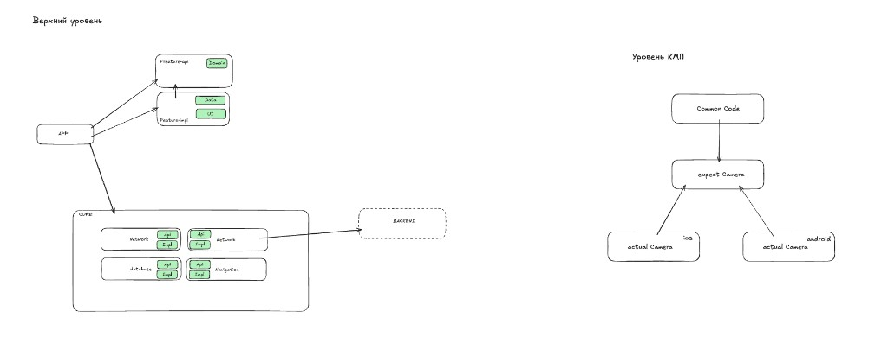
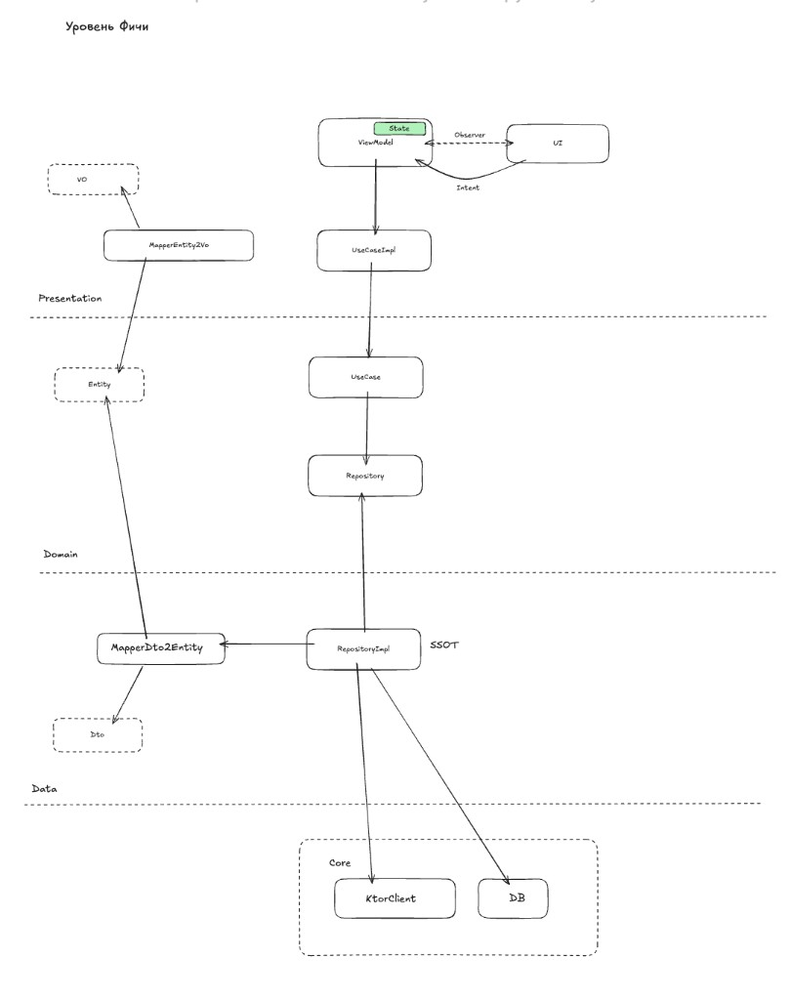
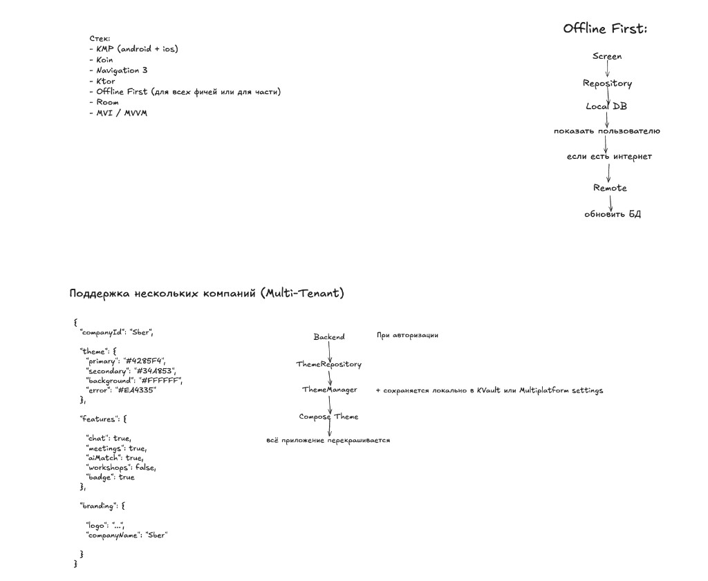

# Architecture

Architecture is **still evolving**. This document has two parts:

1. **Target vision** — intended module / feature / data model (from team diagrams).
2. **Current repository state** — what agents must follow today.

Agents follow what exists in code. Target patterns are introduced gradually; do not mass-refactor unrelated features in one task. Stable decisions live in [adr/](../../../../../../navigation/7d89b9e7b5e60eb1.md). Agent rules: [AGENTS.md](../../../../rules/projects/nootinder-mobile/docs/AGENTS.md). Commands: [commands.md](commands.md).

---

## Target vision

Source diagrams: [architecture/diagrams/](../../../../../../navigation/3d8afed3fbd8c94f.md). Status of related ADRs: mostly **Proposed** / **In progress** until the team marks them Accepted.

### Top-level modules



| Layer | Role |
|---|---|
| **APP** (`:androidApp` / `iosApp` / `:shared`) | Entry, composition root, navigation host |
| **Feature-api** | Public contracts; **Domain** (entities, repository/use case interfaces) |
| **Feature-impl** | **Data** + **UI** (repository impl, mappers, Compose, ViewModels, DI); depends on Feature-api |
| **CORE** | Shared infrastructure with Api/Impl split where needed: Network, Database, Navigation |
| **BACKEND** | External HTTP API (outside the app graph) |

Dependency direction: `APP → features + core`; `Feature-impl → Feature-api`; features use core via public APIs, not by reaching into other features’ impl.

### KMP (`expect` / `actual`)

Platform-specific capabilities (camera, secure storage, HTTP engine, permissions, etc.) stay out of `commonMain`:

- `commonMain`: shared logic + `expect` declarations
- `androidMain` / `iosMain`: `actual` implementations

Never call Android-only or iOS-only APIs from `commonMain`.

### Feature layers



Intended flow inside a mature feature (reference: auth; not every feature is this deep yet):

```text
UI  --Intent-->  ViewModel(State)  --Observer-->  UI
                      |
                 UseCaseImpl → UseCase (api)
                                  |
                             Repository (api)
                                  |
                          RepositoryImpl (SSOT)
                           /              \
                     KtorClient            DB
```

| Layer | Types | Notes |
|---|---|---|
| Presentation | UI, ViewModel + State, VO, `MapperEntity2Vo` | Intent in → observe State out (MVI/MVVM style) |
| Domain (`*-api`) | UseCase, Repository, Entity | No Ktor/Room/Compose |
| Data (`*-impl`) | `RepositoryImpl` (SSOT), Dto, `MapperDto2Entity` | Talks to core Network / DB |
| Core | KtorClient, DB (Room target), Navigation | Shared infrastructure |

Data mapping: **Dto → Entity → VO**. Repository is the **single source of truth** for the feature’s data.

Details: [ADR 0002](adr/0002-feature-layered-architecture.md).

### Stack, Offline-First, multi-tenant



**Intended stack**

| Piece | Choice |
|---|---|
| Platforms | KMP (Android + iOS) |
| DI | Koin |
| Navigation | Navigation3 |
| Network | Ktor |
| Local DB | Room (target; not fully wired yet) |
| UI state | MVI / MVVM (ViewModel + StateFlow / intents) |
| Data strategy | Offline-First where the feature needs it |

**Offline-First** (per feature that opts in)

1. Screen → Repository → Local DB  
2. Show cached data immediately  
3. If online → Remote → update DB → UI sees updated stream  

Details: [ADR 0003](adr/0003-offline-first.md).

**Multi-tenant (company branding / feature flags)**

On auth, backend config (theme colors, feature toggles, branding) flows:

`Backend → ThemeRepository → ThemeManager` (persist locally, e.g. KVault / multiplatform settings) → Compose Theme → app recolors / feature set updates.

Example shape of config:

```json
{
  "companyId": "Sber",
  "theme": {
    "primary": "#…",
    "secondary": "#…",
    "background": "#…",
    "error": "#…"
  },
  "features": {
    "chat": true,
    "meetings": true,
    "workshops": false
  },
  "branding": {
    "logo": "…",
    "companyName": "…"
  }
}
```

Details: [ADR 0004](adr/0004-multi-tenant-theming.md).

---

## Current repository state

What exists in the tree today. Prefer this when writing code unless a task explicitly builds toward the target.

### High-level layout

```text
androidApp/          Android entry point
iosApp/              Swift entry + UIViewControllerRepresentable → Shared
shared/              App shell: Compose, Navigation3, Koin root, iOS MainViewController
core/
  presentation/      Theme, shared UI, permissions (expect/actual)
  test-utils/        Shared test helpers
features/
  feature-*-api/     Public contracts (when present / filled)
  feature-*-impl/    UI, ViewModels, DI, implementations
data-source/
  network/           Ktor client + API implementations
  local/             Token / secure storage
```

Composition root for DI: `shared/src/commonMain/kotlin/ru/noosoft/sovpa/koin/InitKoin.kt`  
Platform start: Android `InitKoinAndroid` / iOS `InitKoinIos` from app entry points.

### Where things live today

| Concern | Location |
|---|---|
| UI screens (Compose) | Mostly `features/*/impl/.../presentation` |
| Shared design system | `:core:presentation` |
| Screen state | `ViewModel` + `MutableStateFlow` / `StateFlow` in feature impl |
| Navigation | `:shared` — `navigation/NavigationDestination.kt`, `NavigationImpl.kt`, host in `App.kt` |
| DI | Koin modules per feature/data source; assembled in `:shared` |
| Network | `:data-source:network` (Ktor; OkHttp Android / Darwin iOS via expect/actual) |
| Local / tokens | `:data-source:local` (`TokenStorage`, `SecureTokenStorage` expect/actual) |
| Local DB (Room) | `:data-source:local` — `AppDatabase`, cache DAOs/storages (`sovpa.db`) |
| Offline-First engine | `:core:data` — `CachedRemoteRepository` + `MergeStrategy` |
| Domain contracts | Strongest in `:features:feature-auth-api` (repository + use cases) |
| Platform permissions / camera | `:core:presentation` expect/actual |
| Tenant ThemeManager | **Not implemented yet** (target only) |

Practical walkthrough (My Summits end-to-end): [data-flow-offline-first.md](data-flow-offline-first.md).

### Patterns in use

#### Feature api / impl

See [ADR 0001](adr/0001-modular-feature-api-impl.md).

- `*-api` — entities, interfaces, use case contracts consumed by other modules;
- `*-impl` — UI, ViewModels, DI, repository implementations.

**Current maturity is uneven:**

- **Auth** — fullest example: api + impl + repository + use cases + real `commonTest` with fakes.
- **Events history** — thin api (entity) + impl UI/VM/DI.
- **Profile / main-screen api** — largely placeholders; impl modules hold most code.
- **Summit** — impl only (no api module in `settings.gradle.kts`).

When adding or extending a feature, copy **auth** if you need contracts/tests; otherwise match the nearest sibling feature and do not forcibly introduce empty layers.

#### DI (Koin)

- Feature modules: e.g. `AuthModule`, `ProfileModule`, `EventsHistoryModule`, `MainScreenModule`.
- Data modules: `networkModule`, `localModule`, `platformLocalModule`.
- App bindings: `appModule` in `:shared`.
- Compose: `koinViewModel` / Koin Compose ViewModel where already used.

#### Navigation (Navigation3)

- Destinations as serializable `NavKey` types in `:shared`.
- Imperative navigation helper + `NavDisplay` / `entryProvider` in `App.kt`.
- Do not introduce a second navigation stack library without approval.

#### Networking (Ktor)

- Factory + engine expect/actual.
- API interfaces/impls for Auth, Profile, Summit.
- Helpers such as safe API call / token refresh wiring exist; follow existing patterns in `data-source/network`.

#### Storage

- Secure token storage abstraction in common code (`TokenStorage` / `SecureTokenStorage`).
- Android: EncryptedSharedPreferences (or current actual).
- iOS: platform secure storage actual.
- Room KMP cache DB in `:data-source:local`; offline-first reads via `CachedRemoteRepository` — see [data-flow-offline-first.md](data-flow-offline-first.md).

#### State management

- Unidirectional-ish: ViewModel exposes state flows; screens collect and send events/intents as already done in auth/profile/main screens.
- No separate MVI framework is mandated; Intent → State observation matches the target feature diagram.

### Gap: current vs target

| Target | Today |
|---|---|
| Core Network / DB / Navigation as explicit Api+Impl | Network + local (+ Room) as `data-source:*`; navigation mostly in `:shared` |
| Full Domain in Feature-api | Strongest in auth; other features thinner or placeholder |
| Data + UI in Feature-impl with Dto/Entity/VO mappers | Partially in auth; often flatter elsewhere |
| Offline-First via Repository SSOT + Room | Implemented for profile / summit / history via `CachedRemoteRepository` — [data-flow-offline-first.md](data-flow-offline-first.md) |
| Multi-tenant ThemeManager after auth | Static / shared theme in `:core:presentation` |

---

## What is not decided / incomplete

Treat these as open unless an ADR marks them Accepted:

- Final feature-module discipline (when api is required vs impl-only) — [ADR 0001](adr/0001-modular-feature-api-impl.md).
- How deep domain layers must be outside auth — [ADR 0002](adr/0002-feature-layered-architecture.md).
- Room module placement under `core` vs `data-source`, and which features are Offline-First first — [ADR 0003](adr/0003-offline-first.md).
- Exact local store for tenant config (KVault vs multiplatform-settings) — [ADR 0004](adr/0004-multi-tenant-theming.md).
- Long-term navigation and deep-link strategy beyond current Navigation3 usage.
- Static analysis (ktlint / detekt / Android lint plugins) — **not configured** as project-wide checks yet.
- CI workflow content and required gates.
- Secure storage / biometric / session policy beyond current token storage.
- Whether summit and other features get proper `*-api` modules.

## Agent rules for architecture

1. Do not introduce heavy frameworks (new DI, navigation, architecture toolkits) without explicit approval.
2. Prefer small, reversible changes that match neighboring code.
3. If a pattern is missing, propose the simplest option consistent with existing modules; ask when multiple approaches conflict.
4. Document meaningful decisions in `docs/adr/` (status Proposed until the team accepts).
5. Do not “fix” uneven api/impl maturity by mass-refactoring unrelated features in the same task.
6. Reference implementation for a full vertical slice: **feature-auth-api + feature-auth-impl**.
7. When implementing toward the target vision, keep `commonMain` platform-safe and update all `expect`/`actual` together.
